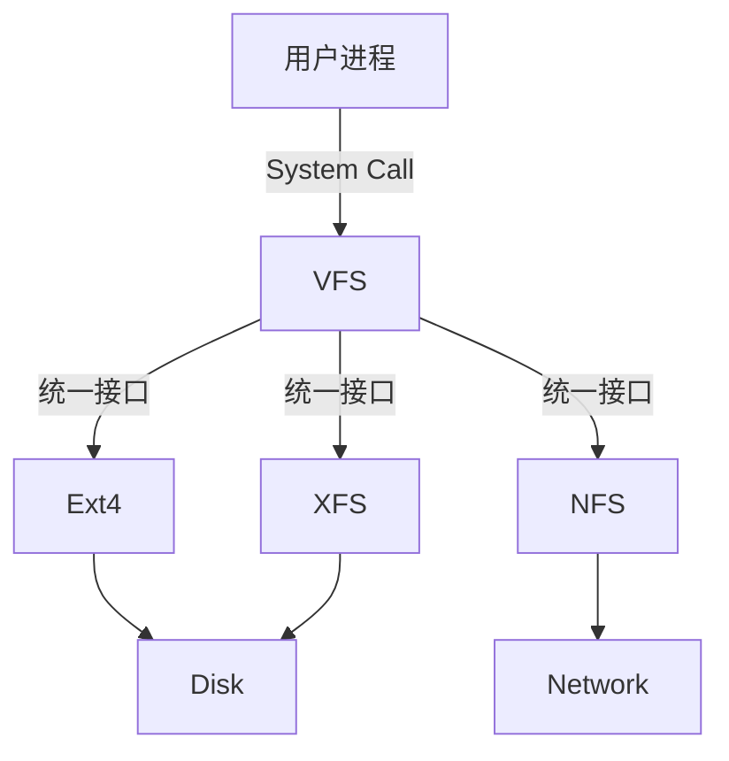

# File System

## TL;DR

- 内核用 VFS 把“所有文件系统”化成四个对象：**superblock（整卷）/ inode（元数据）/ dentry（名字→inode）/ file（这次打开的实例，带偏移量）**；`open/read/write` 只是把请求转发给具体实现。
- **文件名不在 inode 里**，在 dentry 里。所以硬链接 = 多个 dentry 指向同一 inode，`ls -l` 的 nlink 就是这个计数。
- **inode 唯一标识文件，不唯一标识名字**：硬链接删一个名字只是 nlink-1，数据还在；软链接有**独立 inode**、内容就是路径，所以能跨文件系统，但源删了就悬空。
- **fd 是进程级索引**，指向打开文件表里的条目——这解释了两件事：fd 会被子进程继承（除非 CLOEXEC），而重定向只是让两个 fd 指向同一个 file 对象（**共享偏移量**）。
- 工程抓手：判断“是不是同一个文件”看 **inode**（`stat`），不是看路径；判断“还有没有人在用”看 **nlink + `lsof`**（已经 unlink 但被持有的文件会占着磁盘）。

## VFS (Virtual File System)

VFS 是 Linux 内核中的一个软件层，用于给用户空间程序提供文件系统接口，同时提供内核中的一个抽象层以支持不同类型的文件系统。

- **统一接口**: `open()`, `read()`, `write()` 等系统调用通过 VFS 转发给具体的文件系统实现（如 ext4, xfs, nfs）。
- **四大对象**:
  1. **Superblock**: 描述整个文件系统的信息（如块大小、总块数）。
  2. **Inode (索引节点)**: 描述文件的元数据（权限、大小、时间、数据块位置）。
  3. **Dentry (目录项)**: 描述文件名与 Inode 的对应关系，构成目录树。
  4. **File**: 进程打开的文件对象，记录偏移量等动态信息。

## 关键概念

### Inode (索引节点)

- **内容**: 文件权限 (mode)、所有者 (uid, gid)、大小 (size)、时间戳 (ctime, mtime, atime)、数据块指针。
- **特点**: 文件名不存储在 Inode 中，而是存储在目录的 Dentry 中。
- **唯一性**: 在一个文件系统中，Inode 号唯一标识一个文件。

### File Descriptor (文件描述符)

- 进程级别的概念。
- 每个进程维护一个打开文件表，FD 是表的索引（整数）。
- 0: stdin, 1: stdout, 2: stderr。

## 链接 (Links)

| 特性           | 硬链接 (Hard Link)             | 软链接/符号链接 (Symbolic Link)    |
| :------------- | :----------------------------- | :--------------------------------- |
| **原理**       | 多个 Dentry 指向同一个 Inode   | 独立的 Inode，内容是目标文件的路径 |
| **Inode**      | 与源文件相同                   | 拥有独立的 Inode                   |
| **跨文件系统** | 不支持                         | 支持                               |
| **针对目录**   | 通常不支持 (防止环路)          | 支持                               |
| **源文件删除** | 链接仍有效 (Inode 引用计数 -1) | 链接失效 (Dangling link)           |
| **命令**       | `ln source target`             | `ln -s source target`              |

## 存储/块设备相关（已移动）

`磁盘调度/RAID/IOPS` 更贴近 I/O/存储主题，已移动到 [I/O Management](io.md)。

## 相关链接

- [I/O Management](io.md)：磁盘调度、RAID、IOPS、零拷贝
- [Process](process.md)：fd 传递、fork/exec 与 CLOEXEC、文件锁
- [Memory Management](memory.md)：page cache、mmap、缺页
- [本地 IPC 的工程语义](ipc.md)：socket 文件也是 inode（权限位就是访问控制）
- [沙箱与进程隔离](sandbox.md)：用 mount namespace 改文件系统视图
- [Concurrency](concurrency.md)：文件锁与内核同步行为
